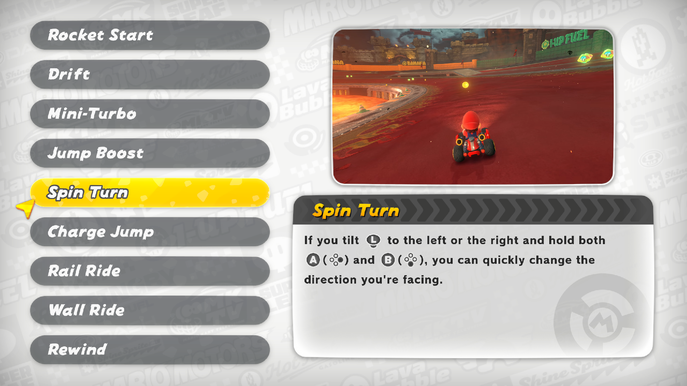
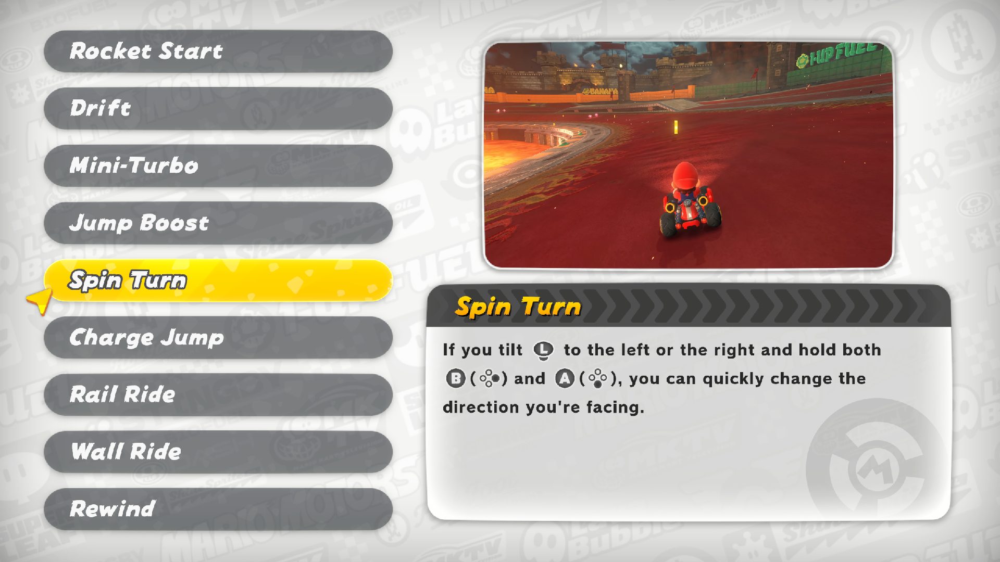

# Mario Kart World: Simple Xbox Icons

A mod that replaces the default Nintendo Switch 2 button prompts with Xbox-style icons in **Mario Kart World**. Perfect for anyone playing with an Xbox controller on emulator.

The mod file is in this repo under `mod/` and ships in the release zip.

## About

Follows the same idea as [kfl-simple-xbox-icons](https://github.com/SavageCore/kfl-simple-xbox-icons) (Kirby and the Forgotten Land) and the original [Simple Xbox Icons (Mario Kart 8 Deluxe)](https://gamebanana.com/mods/519989): swap the Nintendo face button icons (A/B/X/Y) with their Xbox equivalents, so on-screen prompts match the physical layout of your Xbox controller.

The swap keeps the **original Nintendo names** so game logic stays intact - only the image data is exchanged (A<->B, X<->Y).

Prefer PlayStation buttons? See [mkw-simple-playstation-icons](https://github.com/SavageCore/mkw-simple-playstation-icons).

## Preview

Before and after:

## Download

- 🍌 **[GameBanana](https://gamebanana.com/mods/735139)** _(primary)_
- 📦 **[GitHub Releases](https://github.com/SavageCore/mkw-simple-xbox-icons/releases)**

## Installation (Eglantine)

Eglantine is an Eden fork with Switch 2 support: https://github.com/Djihads80/Eglantine

Title ID for Mario Kart World: `0400C3F00006E000`

1. Download the release zip.
2. In Eglantine, right-click the game → **Configure Game** → **Add-Ons** tab.
3. Click **Import Mod from ZIP** and select the downloaded zip.
4. Enable the mod and launch the game.

## Want to Make Your Own?

Check out the **[Icon Swap Guide](guides/GUIDE.md)** for the MKW-specific walkthrough, and [Running Switch Toolbox on Linux](guides/SWITCH-TOOLBOX-LINUX.md) for Bottles setup.

## Credits

- Template repo: [kfl-simple-xbox-icons](https://github.com/SavageCore/kfl-simple-xbox-icons)
